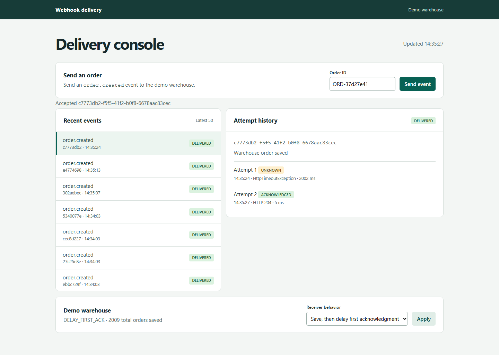

# Webhook Delivery

A Java and PostgreSQL webhook sender with durable acceptance, retry history, and worker crash recovery. The included warehouse lets you watch an order get saved even when the sender misses its acknowledgment.



## Verified behavior

All 13 Java tests passed, including 6 PostgreSQL integration tests. Live demo checks verified concurrent idempotent intake, recovery from receiver errors, retry after a lost acknowledgment, and manual replay with preserved history. In a separate SIGKILL experiment, the workers recovered an expired claim after restart and delivered the event on the second attempt. [Worker crash evidence](docs/measurements/worker-crash.json)

A local burst of 1,000 events through four submitting clients and two workers produced 1,000 acknowledged events and 1,000 warehouse receipts. The observed drain time was 12.383 seconds, with an 8.263-second p95 from database acceptance to recorded acknowledgment. This measures queueing under a burst on a shared Windows development machine. [Results and raw evidence](docs/results.md)

## Run locally

Install Docker with Compose and run from this directory. In PowerShell:

```powershell
Copy-Item .env.example .env
docker compose up --build -d
```

On Linux or macOS, use `cp .env.example .env` for the first command. The example credentials are for this local demo. Open [the delivery console](http://localhost:8080) once the services are ready. Compose starts the API, two workers, PostgreSQL 16, and a warehouse receiver. The database uses a named volume. Only the API and warehouse ports are published, both on loopback. To stop the demo and keep its data, run `docker compose down`.

### See a lost acknowledgment

1. In **Demo warehouse**, choose **Save, then delay first acknowledgment** and apply it.
2. Send an order. The warehouse commits the first request and delays its response beyond the sender's two-second timeout.
3. Inspect the attempt history. The sender records an unknown outcome, then retries using the same event ID. The warehouse's unique key keeps one order. The second response acknowledges delivery.
4. Switch the warehouse back to **Accept deliveries**. Run `python scripts/verify_demo.py` to exercise outages, lost acknowledgments, and replay automatically.

## Delivery contract

An accepted event and its queue entry are the same PostgreSQL row. The API returns 202 after commit. Retrying an ingest key with an equivalent JSON payload, event type, and destination returns the original event ID. Conflicting reuse returns 409.

Each worker claims one due event using `FOR UPDATE SKIP LOCKED`. The short transaction writes a claim token, an eight-second lease, and a numbered attempt. It releases its locks before sending HTTP. The receiver verifies HMAC-SHA256 over the event ID, event type, and exact body bytes.

| Observation | Action |
|---|---|
| HTTP 2xx | Mark delivered |
| Timeout or I/O error | Record UNKNOWN and retry while budget remains |
| HTTP 408, 429, or 5xx | Retry with exponential backoff and jitter |
| Other HTTP responses | Mark dead |
| Worker disappears | On lease expiry, record UNKNOWN and retry while budget remains |
| Five claims used without acknowledgment | Mark dead, available for manual replay |

An event moves from PENDING to DELIVERING, then to DELIVERED, PENDING, or DEAD. A manual replay moves DEAD to PENDING with a fresh budget, keeping identity and history. A claim counts against the budget even if the worker dies before sending. Completion is conditional on a current, unexpired token. An old HTTP request can overlap a newer attempt; a late worker cannot overwrite the newer owner's result. The demo receiver enforces one order per event ID.

## API

| Request | Result |
|---|---|
| `POST /events` | Accept an event with an `Idempotency-Key` header |
| `GET /events` | Latest 50 events |
| `GET /events/{id}` | Event state and all attempts, read from one database snapshot |
| `POST /events/{id}/replay` | Replay a dead event |
| Warehouse `GET /demo/orders/{id}` | Whether the receiver committed this event |

Example in PowerShell:

```powershell
$body = '{"destination":"warehouse","eventType":"order.created","payload":{"orderId":"A104"}}'
$headers = @{ 'Idempotency-Key' = 'demo-A104' }
$receipt = Invoke-RestMethod http://localhost:8080/events -Method Post -ContentType application/json -Headers $headers -Body $body
Invoke-RestMethod "http://localhost:8080/events/$($receipt.id)"
```

## Engineering decisions

- **PostgreSQL as the queue.** Durable intake and claiming fit the same database transaction model. A separate broker would add another handoff to coordinate. Polling costs database work even when the queue is empty.
- **Two identities.** The event ID survives retries and replay. The lease token changes on every claim. These protect the receiver's business operation and the sender's queue state respectively.
- **Bounded retries.** A persistent outage eventually becomes visible as DEAD. A timeout describes what the sender observed; a receiver may already have committed the event.
- **Local scope.** The destination is configured by name. The demo uses one warehouse, two independently running single-delivery workers, and no cross-event ordering or per-destination fairness guarantee. Dashboard and replay controls are intended for a trusted local demo.

## Verify

With a JDK 17+ and Docker available, run `.\mvnw.cmd verify` (Windows) or `sh mvnw verify` (Linux/macOS). Unit tests cover signing and retry decisions. Integration tests use a disposable PostgreSQL instance and include competing claimants, stale completion, concurrent ingest, real HTTP timeouts, and replay. Run `.\mvnw.cmd test` for unit tests alone.

With the demo running and the receiver healthy, use Python 3.9+:

```text
python scripts/benchmark.py --events 100 --clients 4
```

To repeat the live failure checks, run `python scripts/verify_demo.py`. It creates four test events, temporarily changes the demo receiver's behavior, and restores the original behavior afterward. Run it independently of the throughput benchmark and other submissions.

See [verification and measurements](docs/results.md) for the scope of each result. The stack is Java 17, Spring Boot, Spring JDBC, Flyway, PostgreSQL, and a browser dashboard built with HTML, CSS, and JavaScript.
